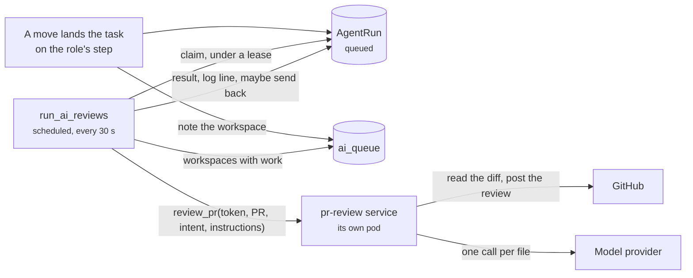

# AI responsibilities

A role can hand part of its work to an AI model. Code review is the first
such responsibility: when a task lands on one of the role's steps, the
linked pull request is reviewed and the review is posted on GitHub. Runs are
jobs in the workspace's own graph, and a separate review service does the
model calls.
{ .fl-lede }

## Responsibilities belong to roles

A step's owner is a role (see [Flow lines](flow-lines.md)), and a role's
responsibilities run when a task lands on a step it owns. A responsibility
can be kept to some of the role's steps (`on_steps`); with none listed, it
runs on all of them. Each one carries:

| Setting | Meaning |
| --- | --- |
| Instructions | What the team wants checked, up to 2,000 characters, sent with every review. |
| Mode | **Comment** posts the review and leaves the task where it is. **Request changes** posts a review with a blocking finding as `REQUEST_CHANGES` and sends the task back along its step's "changes requested" arrow. |
| Model | The model name, or empty for the server's `LLM_MODEL` (default `gpt-4o-mini`). |
| Enabled | Off keeps the settings and queues nothing. |

The workspace's **AI switch** (Workspace, Organization) is off by default.
While it is off, nothing is queued and nothing leaves the workspace.

On the flow line, a step whose owner has responsibilities that run there
carries an **AI** mark, and the step's inspector names them.

## When a run is queued

- **A task lands on the step.** Any move queues a run: a drag, the sheet, a
  GitHub trigger. The move's log line says what was queued, or why nothing
  was ("AI is off", "no linked pull request", "daily AI budget reached").
- **New commits arrive** on the pull request while the task waits on that
  step. A run already queued reads the newest commit when it runs, so it is
  not doubled. A run in progress keeps reviewing the commit it started on,
  and the new commit queues behind it.

A task needs a linked pull request: the PR link on the task, or the one the
GitHub sync linked through "Closes #N". At most one run per task and
responsibility is queued at a time.

## What a run does

The runner claims due runs per workspace under a lease, so two pods never
review the same run. It then calls the review service outside any
transaction:

1. Read the pull request. A closed one is skipped, and so is a head commit
   this responsibility has already reviewed.
2. Collect the changed files. Removed, binary, lock, generated and vendored
   files are left out and listed in the review.
3. Review each file's added lines with the model, at most four at a time,
   then write a short summary.
4. Post one GitHub review on the reviewed commit, with inline comments on
   the lines the findings name. If GitHub refuses an inline line, the
   findings go into the review body instead.

The result lands on the run and in the task's log ("AI code review · 2
comments, 1 blocking"). In request-changes mode, the task goes back only if
it is still on the step the run was queued for.

## Runs, retries and failures

| Status | Meaning |
| --- | --- |
| `queued` | Waiting for the runner, or for its backoff after a retryable failure. |
| `running` | Claimed. A claim whose lease lapses (a pod died) is taken back. |
| `done` | Reviewed and posted. |
| `skipped` | Nothing to do: a closed PR, a commit already reviewed, a responsibility switched off or a task deleted. |
| `failed` | GitHub refused (403: the App lacks *Pull requests: read and write*), GitHub is not connected, or the retries ran out. |
| `cancelled` | Stopped from the task sheet. Nothing is posted for it. |

A GitHub 5xx, a rate limit or an unreachable review service is retried with
backoff, up to three attempts. The task sheet's **AI reviews** section lists
the task's runs with their findings and a link to the review, plus **Retry**
for a failed, skipped or cancelled run and **Cancel** for an open one. While
a run is open, the board row shows "AI review queued" or "AI reviewing".

## Budgets

| Limit | Value |
| --- | --- |
| Runs per workspace per day | 50 |
| Files per review | 60 |
| Changed lines per review | 3,000 |
| Input tokens per review | 200,000 |
| Inline comments per review | 20 |

A pull request over a limit is reviewed up to it, and the review lists
what was left out. A workspace over its daily budget queues nothing more
that day, and the move's log line says so.

## What is sent to the model

Only while the AI switch is on, and only for a task a responsibility runs on:

- the added lines of the pull request's changed files (the diff, never the
  whole repository)
- the task's title and the first line of its notes
- the team's instructions for that responsibility

They go to the model provider the server is set up with. Nothing else in
the workspace is sent, and no pull request content is written to the logs.

## Where it runs

The review service is a second Jac app in the same project (`[apps.pr_review]`
in `jac.toml`, entry `review/service.jac`), deployed as its own pod. The
runner calls it as an awaited bridge function, signed with
`JAC_BRIDGE_TOKEN`. The service never reads a workspace graph: the runner
passes the GitHub installation token with each call. Signals and the kill
switch are on [Operations](../deploy/operations.md#ai-responsibilities), and
the walkers are in the [API reference](../api/agents.md).
